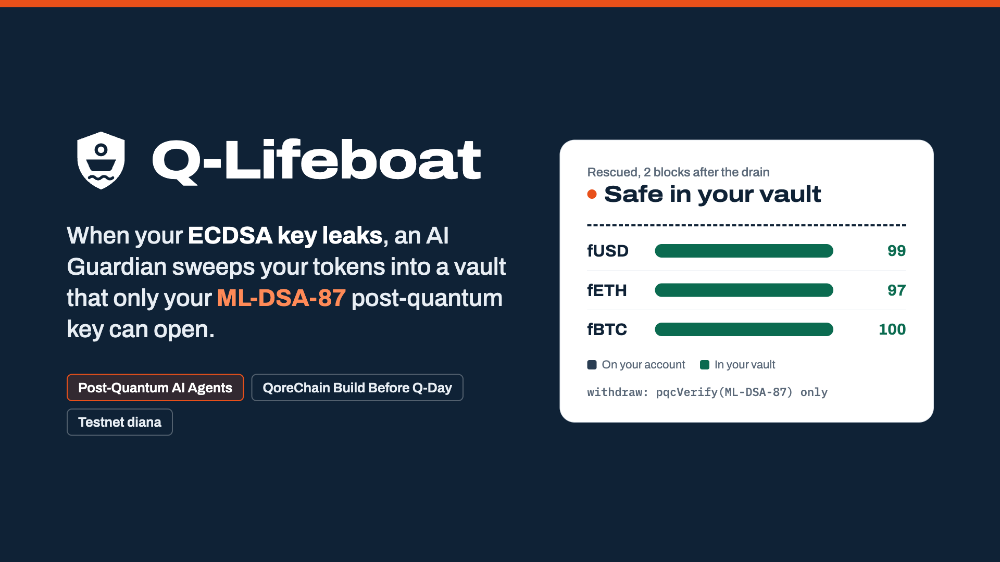

# Q-Lifeboat

**A post-quantum lifeboat for your EVM tokens on QoreChain.** When the classical (ECDSA) key behind your account leaks, an
autonomous Guardian sweeps your tokens into a vault that only your ML-DSA-87 key can open.



> **Status:** working prototype on the QoreChain testnet `qorechain-diana` (EVM chain id 9800). Test tokens have no value. The
> contract went through two AI audit passes (QCAI), not a human audit. Do not use it with real funds. Two ways to use it: in a
> browser with nothing installed (a hosted Guardian per account), or self-hosted with your own agent and keys.
>
> **Live (testnet): https://q-lifeboat.fly.dev**

## Why

QoreChain accounts are hybrid: native transactions need both a classical secp256k1 signature and a post-quantum ML-DSA-87
signature. To use EVM dApps, an owner opens an **EVM window**, and inside it a transaction needs only the ECDSA signature.

Whoever holds that ECDSA key can drain the owner's ERC-20s until the window closes. That could be a quantum attacker after
Q-Day, but today it is just as likely malware, a phishing site or a leaked seed. Blocks take about 1.4 s, so a human notices too
late.

Q-Lifeboat covers that gap. It watches the account, reacts within a block or two, and parks what is left behind the owner's
post-quantum key.

## How it works

```
 leaked ECDSA key / phished approval ──▶ owner's tokens on the EVM lane
                                              │  Transfer + Approval logs, every block
                                              ▼
 Guardian agent ── fixed rules decide (rules.ts); an LLM only writes the report
        │  vault.rescue(token), sent from the guardian's own account inside its own window
        ▼
 GuardianVault ── withdraw(to, token, amount, sig) only with an ML-DSA-87 signature (pqcVerify) ──▶ a new, safe address
        │
        └─ signed incident report: ed25519 (agent key) + QoreSign co-signature (guardian, secp256k1 + ML-DSA-87)
           → verified in the dashboard against the chain, not taken on the agent's word
```

1. **Protect.** The owner deploys a `GuardianVault(owner, guardian)` and approves it for each token (fUSD, fETH, fBTC on
   testnet). The owner then links the Guardian's key to the account with an on-chain spending rule that allows exactly one call:
   `vault.rescue`.
2. **Watch.** The agent reads every outbound `Transfer` and `Approval` from the account.
3. **Decide.** It rescues when tokens move to an address the owner doesn't trust, or above a threshold, or when an approval goes
   to an untrusted spender. Lowering the vault's own allowance raises an alert. The decision is plain code in
   [`apps/agent/src/rules.ts`](apps/agent/src/rules.ts); no model is involved.
4. **Rescue.** The agent sends `vault.rescue(token)` from the guardian account. The vault pulls `min(balance, allowance)` from the
   owner into itself. Funds can only ever move owner → vault, whoever calls.
5. **Report.** The agent publishes an incident report, signed twice. The dashboard checks it in the browser against the chain:
   - the signing key is linked to the owner on chain;
   - the guardian's ML-DSA-87 key is the one registered on chain;
   - each rescue tx emitted the `Rescued` event it claims.
6. **Recover.** The owner signs a withdrawal on their own machine with the ML-DSA-87 key (Guardian Signer, `pnpm cli
   sign-withdraw`). Any funded account can submit it. The signature binds chain, vault, recipient, token, amount and nonce.

## The agent is boxed in

The Guardian is an autonomous agent, so what it **cannot** do matters as much as what it does. Every limit below is enforced by
the chain or the contract, not by the agent's own code.

| Key | Held by | What it can do | Enforced by |
|---|---|---|---|
| Owner ML-DSA-87 | the owner, offline | Open and close EVM windows, link and revoke the agent, sign vault withdrawals | QoreChain hybrid signatures, `pqcVerify` |
| Owner ECDSA | the owner (assumed leaked) | Send EVM txs while a window is open, within its tx / value / block budget and target list | the EVM window |
| Guardian account (secp256k1 + ML-DSA-87) | the agent | Call `vault.rescue` (owner → vault only) from its own window, scoped to the vault; co-sign reports | `GuardianVault` (`owner`/`guardian` immutable, no setters), the guardian's window |
| Agent ed25519 key | the agent | Sign reports. On chain its spending rule allows only `<vault>/rescue`, `uqor` denoms, 1 QOR per tx, 3 QOR per day, 30-day expiry | the account's spending rules |

Even with every agent key stolen, an attacker can only move the owner's tokens into the owner's own vault. Getting them out
needs the owner's ML-DSA-87 key.

## Honest limits

Q-Lifeboat reacts to what lands on chain. It does not see the mempool, so it never stops the first transaction.

- **A one-shot drain is not stopped.** A `transfer` of the whole balance in one tx inside an open window is final before the
  Guardian sees it. The window bounds QOR and gas, not tokens, and spending rules do not bind the owner's own ECDSA key. The real
  defence is a **closed window by default**: with no window, a leaked ECDSA key moves nothing. Q-Lifeboat covers the time a
  window has to be open, drains spread over several txs, and the gap between an `approve` and the `transferFrom` that follows.
- **A drainer as fast as the Guardian wins the approval race.** On diana the rescue lands 1-2 blocks after a phished approval.
  A drainer that waits 2 blocks got nothing (3 of 3 runs). One that pulls the moment it sees the approval won 1 of 2, and lost
  the other only on the rescue's higher priority fee in a shared block.
- **Revoking the vault's allowance is a race too.** The Guardian raises an alert; it cannot undo it.
- **Someone has to keep the Guardian running.** In local mode it runs on the owner's machine; hosted, one service runs every
  owner's Guardian and holds their keys (it can switch protection off or forge reports, never take vault funds). While it is
  stopped nothing watches. "Rescue now" in the local dashboard is the manual fallback.
- **The report's post-quantum co-signature can be missing.** Older reports, or a co-signing failure, carry only the classical
  ed25519 signature, and the dashboard says so.

Details and the full threat model: [`docs/THREAT_MODEL.md`](docs/THREAT_MODEL.md).

## Try it in your browser

No extension, no terminal and no QOR of your own. Open **https://q-lifeboat.fly.dev** and click **Get protected**. Setup
runs in three phases:

1. **Your wallet and recovery code.** A key is made in the browser and stored encrypted under your password. Then your
   recovery code `QRC1-…`: shown once and never stored, it derives your ML-DSA-87 key, the only key that can take tokens out
   of your vault. Write it down, or copy or download it (the file warns what it can do); type two groups back to confirm it.
2. **Starter pack.** The service sends 2.5 testnet QOR for fees.
3. **Turn on protection.** One click runs the rest with a live checklist: register your post-quantum key, get your Guardian,
   create your vault, approvals and link. The vault deploy and the approvals are signed in the browser inside short EVM
   windows sized to exactly those transactions, and the Guardian's key is linked with a rule that allows only `vault.rescue`.

Then the app opens on **Dashboard**, with **Activity**, **Vault** and **Settings** beside it:

- **Test your protection** (Dashboard): send 10 fUSD to an address nobody trusts, as a thief would (100 test fUSD are minted
  first when the account has too few). The Guardian moves the rest into your vault a block or two later (on diana: 2 blocks,
  90% kept); the Dashboard turns orange and the signed report opens from **Activity** with every check ✓.
- **Vault**: pick a token and amount, a fresh address (the leaked account and the vault itself are refused), review, sign.
  The withdrawal is signed in the tab with ML-DSA-87.
- **Settings**: trusted wallets and apps, and the largest trusted transfer. Each change is signed with your recovery code.

Your password and recovery code are asked for once per session, only when an action needs to sign. Each setup step turns ✓
only when the chain or the service confirms it, so you can close the tab and come back. Your Guardian opens its own window
just before yours and costs nothing while your account's window is closed. What the hosted service can and cannot do is in
the threat model (T21–T27): it can never move tokens out of your vault.

On the public URL three fresh browsers ran setup, an attack and a withdrawal on 2026-11-26 (before the UX rebuild); the fastest went from the landing page to its
withdrawal in 2 min 32 s ([EVIDENCE, Task 12](docs/EVIDENCE.md#plan-task-12-the-public-url-three-fresh-browsers-on-diana-2026-11-26)).
The public service is one small machine: it watches at most 4 accounts at once and hands out 3 starter packs per IP per day.
When it is full, the landing page says onboarding is paused; [run it yourself](#run-it-yourself) instead.

## Run it yourself

Requirements: Node >= 22, pnpm, [Foundry](https://book.getfoundry.sh/), and MetaMask for the dashboard's wallet actions. Testnet
QOR comes from the [faucet](https://dashboard.qorechain.io/faucet).

```bash
git clone https://github.com/hms1499/q-lifeboat && cd q-lifeboat
pnpm install
cd contracts && forge build && forge test && cd ..   # the dashboard and the CLI read contracts/out/
cp .env.example .env                                 # fill it in, never commit it
```

`.env` holds:
- the owner's mnemonic (`OWNER_MNEMONIC`);
- the guardian account (`GAS_MNEMONIC`, `GUARDIAN_ADDRESS`), funded with a few QOR for window fees and gas;
- the agent's ed25519 key (`AGENT_ED25519_SK`);
- the vault and token addresses;
- optionally, alert channels (`TELEGRAM_BOT_TOKEN`, `TELEGRAM_CHAT_ID`, `ALERT_WEBHOOK_URL`) and `ANTHROPIC_API_KEY` for LLM-written
  summaries (a template is used without it).

Every variable is described in [`.env.example`](.env.example).

### Run the hosted service

The browser product above, on your machine: one service serves the dashboard, proxies diana's REST and RPC, hands out
starter packs from `FUNDER_MNEMONIC`, and runs one unchanged agent per owner behind a gateway that forwards writes only with
the owner's ML-DSA-87 signature.

```bash
cd contracts && forge build && cd ..
VITE_HOSTED=1 pnpm -F dashboard build
cd apps/hosted && set -a && . ../../.env && set +a && HOSTED_DATA_DIR=~/.config/qday/hosted PORT=8080 pnpm start
# or: docker build -f apps/hosted/Dockerfile -t qlifeboat-hosted .   (see the Dockerfile for the run command)
```

Owner state and guardian secrets live in `HOSTED_DATA_DIR` (0600), never in the repo. `HOSTED_MAX_AGENTS` caps the agents
(default 40): on Fly each one takes ~185 MB and the service ~172 MB, so size it to the host's RAM.

The public instance runs on [Fly.io](https://fly.io) from [`fly.toml`](fly.toml) (one Machine, a volume on `/data`, auto-stop
off so the Guardians never sleep):

```bash
cd contracts && forge build && cd ..
fly apps create <app> && fly volumes create qlifeboat_data --size 1 --region sin -a <app>
fly secrets set FUNDER_MNEMONIC="…" -a <app> --stage      # never in fly.toml
fly deploy -a <app> --ha=false --remote-only              # one Machine: the volume belongs to it
```

### Run the Guardian and the dashboard (local mode)

```bash
pnpm agent              # watches OWNER_MNEMONIC's account; local API on 127.0.0.1:8787
pnpm -F dashboard dev   # http://127.0.0.1:5173
```

The dashboard has these screens:
- **Overview:** exposure right now, and where each token sits (account vs vault).
- **Incidents:** every report, verified in the browser.
- **Recover:** load and submit a signed withdrawal.
- **Protect:** step-by-step onboarding with MetaMask and the CLI.
- **Rules:** trusted wallets and apps, the threshold, the on-chain permission, and turning protection off.
- **Fire drill:** a full attack and rescue on a throwaway account.

### Protect an account

From the dashboard's **Protect** screen, or with the CLI:

```bash
pnpm cli setup                       # scoped EVM window + agent link with its spending rule + vault approvals
pnpm cli window close                # keep the window closed when you are not using it
pnpm cli window open [--topup QOR]   # open a scoped window (default 1800 blocks, 5 txs) when you need the EVM lane
pnpm cli status                      # window, rules, linked keys and balances, read only
```

Hybrid transactions, such as opening a window or linking a key, need the ML-DSA-87 key, so they run in the CLI. EVM
transactions, such as deploying the vault, approvals, "Rescue now" and submitting a withdrawal, can be signed in MetaMask
inside an open window.

### Recover

```bash
pnpm cli sign-withdraw <to> <fUSD|fETH|fBTC|QOR|0x…> <amount>   # Guardian Signer: ML-DSA-87, on your machine
pnpm cli withdraw withdrawal.json                               # or load it in the dashboard's Recover screen
```

### Turn protection off

**Rules → Turn off protection.** First revoke the vault's allowances in MetaMask; that is what actually stops rescues. Then
revoke the Guardian's key with `pnpm cli unlink`, and stop the agent. To turn it back on, approve the tokens again and run
`pnpm cli link`.

## Demos

Each demo run creates a fresh owner, funded by `FUNDER_MNEMONIC` (about 2 QOR), with its own vault and agent. Stop `pnpm agent`
first: the demo runs its own agent on port 8787.

```bash
./demo.sh                             # leaked key: drains, rescue, forged withdraw refused, agent-key misuse refused, recovery
./demo.sh --runs 3                    # three runs in a row
./demo.sh --phish                     # approval phishing, the drainer pulls at once (worst case)
./demo.sh --phish --drainer-delay 2   # ... the drainer pulls 2 blocks after the approval
./demo.sh --drill                     # fire drill with its own guardian (also from the dashboard)
bash scripts/test-demo.sh             # offline test of demo.sh's flow (stub pnpm, no chain)
```

A `./demo.sh` run PASSes only when all of these hold:
- the rescue lands at most 3 blocks after the first drain;
- at least 80% of the value is kept;
- a withdrawal with a forged signature reverts with `BadSignature`;
- the agent's key calling `fUSD.transfer` directly is refused by the chain.

Run secrets stay in `~/.config/qday/runs/<run id>/` (mode 0600), never in the repo.

## Verify it yourself

Every claim about the chain is backed by a transaction on diana in [`docs/EVIDENCE.md`](docs/EVIDENCE.md). Some to start with:

| Claim | Transaction |
|---|---|
| The vault (v3) is deployed with an immutable owner and guardian | `0x77f4eea0e461cf17110d10656cc94eaad5c34afc75342bfee30c3df2e9846a71` (EVM) |
| A rescue lands 1 block after the drain (`./demo.sh --runs 3`: 3 of 3, 1 block each, 90% kept) | rescue `0xa1d78c953d806250a9ddcf2b478f5a78d842eb83472113e438d75f7baeb84f0b`, sent by the guardian (EVM) |
| A withdrawal with a forged signature reverts `BadSignature` | `0x3b261065ba9c9963629f4bfd7e7698bdcbac47628b5939aad295b850876cc4a5` (EVM) |
| The chain refuses the agent's key calling a token directly | [`7E9B629F…`](https://explore.qore.network/tx/7E9B629F2A8508848A350AF05AD63A36661F11D83A4A87EEE1D8B6FC497D0DDF) |
| The guardian opens its own window, scoped to the vault | [`0EE681A6…`](https://explore.qore.network/tx/0EE681A678902D0E80B9D7CDC3DA737569C14555FA0168CB997B0530BD54FE13) |
| The owner links the agent with a 30-day spending rule | [`1D5FEE88…`](https://explore.qore.network/tx/1D5FEE885111FA58FB57300637A35CED7265275F4CE6E48F33539E2B8B2B2934) |
| Approval phishing: the rescue lands before the drainer's pull | runs in [EVIDENCE, Task 7](docs/EVIDENCE.md#task-7-approval-phishing-race-on-diana-2026-11-24) |
| A report co-signed with ML-DSA-87 verifies; a changed copy fails | [EVIDENCE, gap 3](docs/EVIDENCE.md#submission-gap-3-post-quantum-co-signed-incident-reports-2026-11-24) |
| A fresh browser onboards with no extension and no QOR: register, vault, approvals, link, activate | [EVIDENCE, Tasks 6 + 9](docs/EVIDENCE.md#plan-task-6--9-self-serve-onboarding-in-a-fresh-browser-on-diana-2026-11-25) |
| From the browser: rescue 2 blocks after the attack transfer (90% kept); 50 fUSD withdrawn with the recovery-code key | [EVIDENCE, Task 10](docs/EVIDENCE.md#plan-task-10-try-an-attack-and-withdraw-in-the-browser-on-diana-2026-11-25) |
| On the public URL: three fresh browsers onboard, get rescued 2 blocks after the attack and withdraw; a restart brings every Guardian back | [EVIDENCE, Task 12](docs/EVIDENCE.md#plan-task-12-the-public-url-three-fresh-browsers-on-diana-2026-11-26) |

The diana explorer shows Cosmos-lane transactions only. Check EVM hashes with `eth_getTransactionReceipt` on
`https://evm-testnet.qore.host`.

## QoreChain features used

| Feature | Where | Why |
|---|---|---|
| Hybrid secp256k1 + ML-DSA-87 transactions | [`apps/cli/src/chain.ts`](apps/cli/src/chain.ts) | Opening windows and linking the agent need the post-quantum key |
| Scoped EVM windows (`allowedTargets`, `maxTxs`, `maxValue`, block expiry) | [`apps/agent/src/window.ts`](apps/agent/src/window.ts), [`apps/cli/src/window.ts`](apps/cli/src/window.ts) | The guardian's own window reaches only the vault; the owner's window caps what a leaked key can do |
| Smart-account spending rules (`allowedEvmCalls`, `allowedDenoms`, per-tx and daily limits, expiry), `MsgRevokeAuthenticator` | [`apps/cli/src/setup.ts`](apps/cli/src/setup.ts), [`link.ts`](apps/cli/src/link.ts), [`unlink.ts`](apps/cli/src/unlink.ts) | The agent's key may call `vault.rescue` and nothing else |
| `pqcVerify` / `pqcKeyStatus` precompiles | [`contracts/src/GuardianVault.sol`](contracts/src/GuardianVault.sol) | Withdrawals need the owner's registered and proven ML-DSA-87 key |
| ML-DSA-87 signing (Guardian Signer) | [`apps/cli/src/signer.ts`](apps/cli/src/signer.ts) | The withdrawal signature, made offline |
| Authenticated messaging (QoreSign, secp256k1 + ML-DSA-87) | [`apps/agent/src/cosign.ts`](apps/agent/src/cosign.ts), [`apps/dashboard/src/lib/verify.ts`](apps/dashboard/src/lib/verify.ts) | Incident reports co-signed by the vault's guardian and verified against its on-chain key |
| Classical bootstrap of an ML-DSA-87 key (`MsgRegisterPQCKeyV2`) | [`apps/cli/src/fresh.ts`](apps/cli/src/fresh.ts), [`apps/dashboard/src/screens/Start.tsx`](apps/dashboard/src/screens/Start.tsx) | A brand-new account registers its post-quantum key |
| Recovery-code ML-DSA-87 keys (`generatePqcRecoveryCode`, `unifiedAccountFromSeed`) and hybrid txs from a browser | [`apps/dashboard/src/lib/session.ts`](apps/dashboard/src/lib/session.ts), [`ownerTx.ts`](apps/dashboard/src/lib/ownerTx.ts) | The post-quantum key is split from the classical one and never stored; windows and links are signed in the tab |

### Why rescues don't go through the agent's linked key

On QoreChain an agent can act through its linked key with `MsgExecuteEVM`, under the account's spending rules, and an early
version of Q-Lifeboat did exactly that. Since 2026-11-20 diana refuses a token move from the account made inside such a call,
unless the rule lists the token as `erc20/<address>`
([`8508B568…`](https://explore.qore.network/tx/8508B568DE126539BA5DD8CAE4337E0DCFC1F1B6C47323BC4228495037EA84B7)). Listing the
token also lets the key call that token's `transfer` directly
([`CADB1412…`](https://explore.qore.network/tx/CADB1412182E060C3C951959EE155D6E7CF1E5314F413668A8B9A017DE270AC8)). That would
let a stolen agent key send the owner's tokens anywhere.

So the agent rescues from its own account, which the vault pins as its immutable `guardian`. The linked key keeps a spending
rule that allows only `vault.rescue`, and signs the reports.

## Project layout

```
contracts/          GuardianVault.sol, Foundry tests, deploy scripts
packages/core/      shared config, accounts, the withdrawal message (byte-identical to Solidity) and incident format
apps/agent/         watch → rules → rescue → report (+ co-sign), alerts, local API
apps/cli/           setup, link/unlink, windows, Guardian Signer, withdraw, demo tooling
apps/dashboard/     Vite + React dashboard, with the in-app wallet for the hosted product
apps/hosted/        hosted service: dashboard, REST/RPC proxies, starter packs, per-owner agents, signed gateway
docs/               threat model, audit, evidence, specs and plans
demo.sh             end-to-end demo on diana
```

## Development

```bash
cd contracts && forge test -vv       # contract tests
pnpm -F core test                    # TS ↔ Solidity message vector, incident signing
pnpm -F agent test
pnpm -F cli test
pnpm -F dashboard test               # needs `forge build` first (it imports the contract artifact)
pnpm -F hosted test
bash scripts/test-demo.sh
```

Every change is test-first. A claim about the chain counts only with a real transaction on diana, recorded in `docs/EVIDENCE.md`.

## Deployed on diana

| Contract / account | EVM address | Native address |
|---|---|---|
| GuardianVault v3 | `0x776913Abe058941d4c8ac097EE47E29F528f71e6` | `qor1wa5382lqtz2p6ny2czt7u3lznafg7u0xyw84xk` |
| Guardian (agent account) | `0xFf82cAD6638a38d7009D0d5DfB757136B0C03850` | `qor1l7pv44nr3gudwqyap4wlkat3x6cvqwzsvtm0pt` |
| Owner (ML-DSA-87 key registered) | `0xE871748C0922745Ad94d065a388e95eC420A67EB` | `qor1apchfrqfyf694k2dqedr3r54a3pq5eltmjxxpv` |
| fUSD / fETH / fBTC (test tokens, public `mint`) | `0x8478737e5ac2c2cbf70aad17f459d1b8ab8a7a14` / `0x0a958bba25f5fddca1b1f9cec44bdf076a8ea6c5` / `0xbd16bc9ffaddf241593d891844cc4281f5af903e` | |

## Roadmap

- Watch the mempool and front-run drains where the chain exposes pending transactions.
- Run the hosted service on more than one machine, so one outage does not leave every owner unwatched.
- A withdrawal timelock on the vault: a delay the owner can cancel, as a second line behind the ML-DSA-87 check.
- Require the post-quantum co-signature on every report from a cut-over the chain can vouch for.
- A human security audit before any mainnet use.

## Documents

- [Threat model](docs/THREAT_MODEL.md), including the honest limits
- [Audit](docs/AUDIT.md):
  - QCAI Stage 1 on v1: 85/100, MEDIUM (dated PDF of a re-run on the same source).
  - Stage 2 on the final contract: 85/100, MEDIUM, no finding on the guardian path.
  - Reports in [`docs/audit/`](docs/audit).
  - Every finding is fixed, covered by a test, or explained.
- [On-chain evidence](docs/EVIDENCE.md)
- [Spec](docs/specs/2026-11-19-qday-guardian-mvp.md) and [plan](docs/plans/2026-11-19-qday-guardian.md); the browser product:
  [spec](docs/specs/2026-11-25-end-user-product-design.md) and [plan](docs/plans/2026-11-25-end-user-product.md)
- [How AI was used to build it](AI_USAGE.md)

## Acknowledgements

Built for QoreChain's *Build Before Q-Day* developer fest (Post-Quantum AI Agents).

- [`qorechain/build-before-qday`](https://github.com/qorechain/build-before-qday), workshop-2: the `QDayVault` ML-DSA withdrawal
  pattern and the `pq-agent` authenticator flow.
- QoreChain kits:
  - `@qorechain/sdk` and `@qorechain/evm`.
  - `@qorechain/qoresign` (Apache-2.0): hybrid message signatures for the incident reports.
  - `@qorechain/react` was evaluated; it has no hybrid signing path.
- viem, Foundry, React, Vite, `@noble/curves`. Fonts: Archivo and IBM Plex Mono (SIL OFL).

## License

MIT. See [LICENSE](LICENSE).
